<picture>
  <source media="(prefers-color-scheme: dark)" srcset="assets/banner-dark.svg">
  <source media="(prefers-color-scheme: light)" srcset="assets/banner-light.svg">
  
</picture>

  
  
  

 

## About

Software engineer, graduated from **ENSET Mohammedia** (Engineering Degree in Software Engineering & Distributed Information Systems, 2026).
I design and build web applications end to end — secure microservices, event-driven backends and the interfaces on top of them — and lately, **GenAI assistants built on RAG and agentic workflows**.

I care about clean, maintainable code, sensible architecture and shipping things that hold up in production.

 

## Experience

<table>
  <tr>
    <td width="200" valign="top">FEB 2026 — JUL 2026</td>
    <td valign="top">
      <b>Software Engineer</b> · Hepheos — final-year internship 
      Multi-tenant project-lifecycle platform: secure Java 21 / Quarkus microservices (OIDC, Keycloak, jCasbin), Next.js frontend, Kafka, CI/CD with Docker — and an AI assistant combining RAG (LangChain, pgvector, Elasticsearch) with agentic workflows.
    </td>
  </tr>
  <tr>
    <td valign="top">JUL 2025 — SEP 2025</td>
    <td valign="top">
      <b>Full-Stack Developer Intern</b> · Des Customs 
      Mobile app comparing carrier plans, built end to end: FastAPI, PostgreSQL, Redis caching, fully containerized.
    </td>
  </tr>
  <tr>
    <td valign="top">JUL 2024 — AUG 2024</td>
    <td valign="top">
      <b>Web Developer Intern</b> · Algoting 
      Full-stack e-commerce application with React / TypeScript and Node.js.
    </td>
  </tr>
</table>

 

## Tech stack

<table>
  <tr>
    <td width="200"><b>Backend</b></td>
    <td>
      
      &nbsp;
      
    </td>
  </tr>
  <tr>
    <td><b>Frontend</b></td>
    <td></td>
  </tr>
  <tr>
    <td><b>Data &amp; messaging</b></td>
    <td></td>
  </tr>
  <tr>
    <td><b>DevOps &amp; cloud</b></td>
    <td></td>
  </tr>
  <tr>
    <td><b>Security</b></td>
    <td>
      
      
      
      
    </td>
  </tr>
  <tr>
    <td><b>Generative AI</b></td>
    <td>
      
      
      
      
      
    </td>
  </tr>
  <tr>
    <td><b>Testing &amp; practices</b></td>
    <td>
      
      
      
      
      
    </td>
  </tr>
</table>

 

## Certifications

  

## Activity

<picture>
  <source media="(prefers-color-scheme: dark)" srcset="https://streak-stats.demolab.com/?user=KarnasZiad&theme=github-dark-blue&hide_border=true&background=0D1117&ring=34D399&fire=34D399&currStreakLabel=34D399">
  
</picture>

 

Arabic (native) · French (fluent) · English (fluent)

